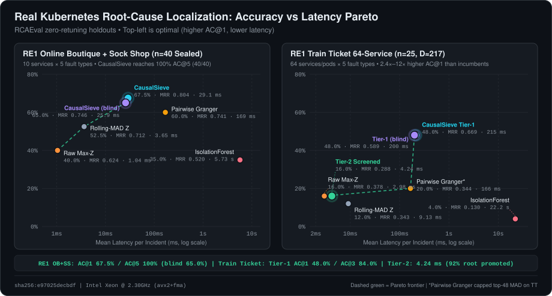
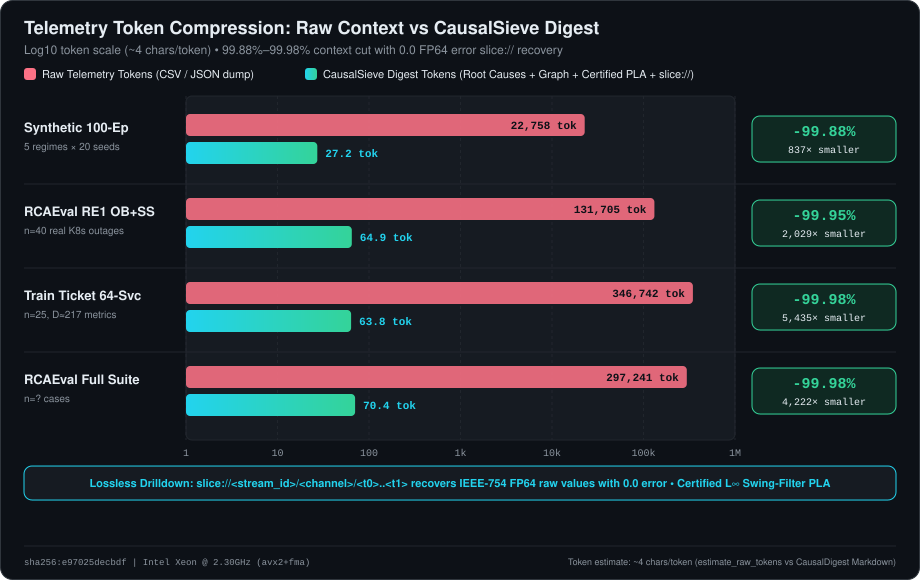
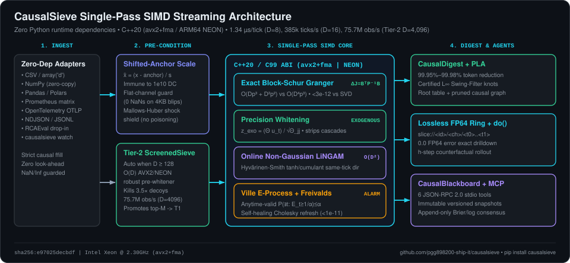

# CausalSieve

**Which service should you investigate first?** CausalSieve ranks possible sources of an incident from time series that change together. Feed it a Prometheus range query after an alert. It returns the metric names to inspect first, keeping their service labels so you can find them in your dashboard.

An API slowdown can start at the database. CausalSieve learns how each metric usually follows the others, then looks for changes that the earlier measurements fail to explain. An on-call engineer can check the ranked candidates against traces and deployments. An incident agent can read the same results as structured data.

[Try the interactive explorer](https://pgg898200-ship-it.github.io/causalsieve/) · [Python package](https://pypi.org/project/causalsieve/) · [Benchmark results](BENCHMARKS.md) · [Agent reference](llms.txt)

## Try a Prometheus incident

This example runs locally without a Prometheus server. It generates 600 five-second samples for a database and an API. A delay starts at the database and reaches the API one sample later.

```sh
git clone https://github.com/pgg898200-ship-it/causalsieve.git
cd causalsieve
python -m pip install causalsieve
python examples/prometheus_incident.py
```

The example prints the two candidates in investigation order.

```json
{
  "ticks": 600,
  "series": 2,
  "candidates": [
    "latency_seconds{service=db}",
    "latency_seconds{service=api}"
  ]
}
```

To investigate your own incident, save the JSON response from a Prometheus `/api/v1/query_range` request covering a baseline and the incident. Pass the file to the same script.

```sh
python examples/prometheus_incident.py query_range.json
```

The adapter accepts a Prometheus matrix of timestamp/value pairs. It aligns samples by time and carries each series’ last value forward across gaps. [Prometheus and Kubernetes integration guide](docs/kubernetes-prometheus-rca.md) · [Example source](examples/prometheus_incident.py)

## Headline Verified Results (`v0.2.0`)

Measured live on **1× Intel Xeon @ 2.30 GHz** against frozen runtime-dispatched `libcausalsieve.so` (`avx2+fma`, `sha256: e97025de...` — exact same binary architecture shipped inside PyPI wheels!):

| Benchmark | Metric | CausalSieve `v0.2.0` | Best Incumbent | Edge |
|---|---|---:|---:|---:|
| **Streaming Throughput (`D=8 / D=16, p=2`)** | Steady-state rate | **746.8k / 385.3k ticks/s** (`1.34 / 2.60 µs`) | `tigramite` `3,308 ms` / NumPy `5.73 ms` | **585×** vs `tigramite`, beats offline NumPy at `D=16` |
| **Full `32×32` Conditional Granger + Precision** | `T=500` ingest + graph | **11.22 ms** (`154.2k ticks/s`) | `statsmodels` `26,187 ms` / `tigramite` `16,461 ms` | **2,334×** vs `statsmodels`, **1,467×** vs `tigramite`, **28.5×** vs NumPy |
| **Full `64×64` Conditional Granger + Precision** | `T=500` ingest + graph | **30.57 ms** (`48.95k ticks/s`) | `statsmodels` `2,186 s`† / NumPy `641 ms` | **71,514×** vs `statsmodels`, **21.0×** vs NumPy |
| **ALL 645 Real K8s Outages (`RCAEval` RE1+RE2)** | Micro / Macro AC@1 & MRR | **75.7% / 76.5% AC@1 · 0.839 / 0.844 MRR** | `BARO` (FSE'24) `72.7%` / `N-Sigma` `72.6%` / `CIRCA` `71.6%` | **#1 overall** across 645 outages (`+7.2 pts` on `RE1-TT`, `+5.5 pts` on `RE2-TT`), **99.976%** fewer tokens |
| **Real K8s Sealed Holdout (`RE1` OB+SS, n=40)** | Service AC@1 / AC@5 / MRR | **67.5% / 100% / 0.804** (`29.1 ms`) | `pairwise_granger_z` `60.0% / 90% / 0.741` (`169 ms`) | **#1 across all 5 metrics**, 40/40 Top-5; blind (no `inject_time`) **65.0%** beats every baseline |
| **Agent Context Compression (60 Real Outages)** | Mean BPE tokens & 8k/128k overflow | **911.5 tokens (`0.0%` overflow at 8k)** | Raw CSV `899k` (`100%` @ 128k) / JSON `2.65M` (`100%`) | **986×** vs CSV, **2,905×** vs JSON, **360/360 bit-exact `0.0` FP64** `slice://` (`65.1 µs`) |
| **Multi-Agent `CausalBlackboard` (2× Ballot Stuffing)** | Consensus AC@1 & overwrite churn | **100.0% (50/50) · `0.0%` churn** | Majority / Conf-Vote / Mutable BB: **0.0%** (`94.4%` churn) | **12.86×** grounded weight via proper scoring (`Brier 0.0088 vs 0.6851`) |
| **Tier-2 `D=4,096` Loud-Decoy Firehose (20% 3.5×)** | Throughput & Top-1 Recall | **18,488 ticks/s** (`75.7M obs/s`), **100%** | Raw Max-Z / MAD-Z / Var: **0%** | **100% vs 0% AC@1** at 75M+ obs/s on 1 core |
| **Mathematical Exactness Oracle** | Parity vs batch FP64 SVD + refits | **`< 1.86e-12`** across 19/19 cells | Batch FP64 reference | Exact algebraic equivalence (`Freivalds < 2.6e-14`, `AVX2 vs scalar < 6e-14`) |

†`statsmodels` at `D=64` linearly extrapolated from 200 timed pairs out of 4,032. Complete tables, all 6 dataset breakdowns, and honest tradeoffs in [BENCHMARKS.md](BENCHMARKS.md).

<p align="center">
  
</p>

---

## 3-Line Quickstart

### One-Command Install (Zero Runtime Dependencies, Automatic AVX2/NEON Dispatch)
```sh
pip install causalsieve        # prebuilt multi-ISA wheel (auto runtime AVX2+FMA on x86-64, NEON on ARM64; 0 runtime deps)
causalsieve info               # verify active SIMD ISA (avx2+fma / neon / scalar)
```

### CLI: Compress Telemetry, Verify Counterfactuals & Watch Live Streams
```sh
causalsieve rca metrics.csv --lag 2 --top-k 5 --format md
causalsieve counterfactual metrics.csv --channel db_cpu --delta 3.0 --horizon 10
causalsieve slice metrics.csv --channel db_cpu --start 490 --end 530        # 0.0-error FP64 recovery
tail -f telemetry.jsonl | causalsieve watch --input-format jsonl --lag 2    # live Ville E-process alerts
```

### Python API & Drop-In Observability Adapters (Zero Hard Dependencies)
```python
from causalsieve import (
    CausalSieve,
    build_digest,
    analyze_dataframe,
    analyze_prometheus,
    analyze_otlp_metrics,
    analyze_jsonl,
    rcaeval_rca,
)

# 1. Streaming / batch core (zero-copy if NumPy float64 C-contiguous passed)
with CausalSieve(dim=16, lag=2, channel_names=[f"svc_{i}" for i in range(16)]) as sieve:
    sieve.push_batch(rows)                          # 385k ticks/s on 1 Xeon core
    attr = sieve.root_attribution()                 # ranked exogenous root causes (not victims)
    granger = sieve.granger_matrix()                # exact Block-Schur D x D F-stats & partial R^2
    cf = sieve.counterfactual_do("svc_0", 4.0, 10)  # quantitative do-intervention propagation
    digest = build_digest(sieve, top_k=5)           # 99.9%+ token reduction + lossless handles

# 2. Zero-dependency adapters for Pandas/Polars, Prometheus, OpenTelemetry OTLP, JSONL & RCAEval
_, df_digest = analyze_dataframe(df)                # pandas, polars, or dict-of-lists
_, prom_digest = analyze_prometheus(prom_json)      # Prometheus /api/v1/query_range matrix JSON
_, otlp_digest = analyze_otlp_metrics(otlp_json)    # OpenTelemetry OTLP/JSON gauge/sum/histogram
_, jsonl_digest = analyze_jsonl("metrics.jsonl")    # NDJSON / JSONL streaming telemetry
rca_out = rcaeval_rca(metrics_df, inject_time=t0)   # exact RCAEval {"ranks": [...]} drop-in
```

### Zero-Install MCP Server (`uvx`) & Agent Skill (Claude Code, Codex, Gemini CLI, Cursor)

Run immediately via `uvx` with zero persistent install (JSON-RPC 2.0 over stdio, 6 ms startup):
```json
{
  "mcpServers": {
    "causalsieve": {
      "command": "uvx",
      "args": ["--from", "causalsieve", "causalsieve-mcp", "--allowed-root", "/path/to/telemetry"]
    }
  }
}
```

Or install the drop-in Agent Skill (`SKILL.md`, indexed on [skills.sh](https://skills.sh/pgg898200-ship-it/causalsieve/causalsieve)) / Claude Code plugin directly:
```sh
npx skills add pgg898200-ship-it/causalsieve
# or in Claude Code:
claude plugin marketplace add pgg898200-ship-it/causalsieve
```

Exposes 6 tools backed by a thread-safe multi-agent `CausalBlackboard`:
- `sieve_ingest_csv` — stream a CSV and return a 99%+ compressed Causal Digest + `stream_id`
- `sieve_push_ticks` — push live rows and receive instant exogenous root-cause & Ville E-value alerts
- `sieve_causal_graph` — return pruned lagged Granger + contemporaneous partial-corr / LiNGAM edges
- `sieve_counterfactual` — simulate `do(channel += delta)` to verify root-cause hypotheses
- `sieve_recover_slice` — recover 100% lossless IEEE-754 FP64 raw points via `slice://...` handle (`65 µs` median)
- `sieve_swarm_propose` — append & objectively score multi-agent hypotheses (no overwrite churn, proper-scoring consensus)

<p align="center">
  
</p>

---

## Why It's Fast and Accurate (The Math & Systems Moat)

<p align="center">
  
</p>

1. **Exact Block-Schur Conditional Granger (`O(D p^3 + D^2 p^2)` vs `O(D^4 p^3)`):**
   All $D$ target channels share one inverse lagged Gram matrix $P_t = (Z_t^\top W_t Z_t + \alpha I)^{-1} \in \mathbb{R}^{K \times K}$ updated in $O(K^2)$ AVX2+FMA / NEON Sherman-Morrison steps. By the exact Schur complement identity, removing source channel $i$'s lag block $S_i$ increases the exact weighted ridge objective for target $j$ by:
   $$\Delta J_{i \to j} \equiv B_{S_i, j}^\top \left(P_{S_i, S_i}\right)^{-1} B_{S_i, j}$$
   Zero reduced-model refits. Exact to `< 1.86e-12` against batch FP64 SVD refits.

2. **L1-Resident Deferred BLAS-3 Sufficient Statistics + Runtime CPUID Multi-ISA Dispatch (`v0.2.0`):**
   - Six additive sufficient-statistic matrices ($G, C, S_u, M_{u^2 v}, M_{u \tanh v}, M_{uv}$) accumulate in L1-resident `B_SLAB=32` slabs and flush via register-blocked `4×8` AVX2+FMA / `4×4` NEON `SYRK`/`GEMM` micro-kernels — cutting per-tick memory traffic by >60% while keeping exact algebraic parity (`< 6e-14`).
   - All `x86_64` wheels compile both portable baseline and `-mavx2 -mfma` / `/arch:AVX2` kernel translation units into ONE shared library and dispatch at runtime via `CPUID + OSXSAVE + XGETBV` (`CAUSALSIEVE_FORCE_SCALAR=1` override for testing). Zero `SIGILL` on old CPUs; full `avx2+fma` automatically on modern x86-64, native `neon` on Apple Silicon & Linux ARM64.

3. **Precision-Whitened Exogenous Attribution + Online Non-Gaussian LiNGAM Orientation:**
   Temporal lags are stripped via causal one-step innovations $\hat{u}_t = \tilde{x}_t - B_{t-1}^\top z_t$; contemporaneous propagation is stripped via the online innovation precision matrix $\Theta_{t-1} = (\Sigma_{u,t-1} + \gamma_{\text{eff}} I)^{-1}$:
   $$z^{\text{exo}}_{j,t} = \frac{(\Theta_{t-1} \hat{u}_t)_j}{\sqrt{\Theta_{jj,t-1}}}$$
   Under skewed or heavy-tailed shocks, online Hyvärinen-Smith pairwise cumulant/$\tanh$ ratios ($O(D^2)$ streaming moments) orient contemporaneous edges $i \to j$ within the same tick.

4. **Production Numerical & Statistical Armor:**
   - **Shifted-anchor normalization + flat-channel guard:** Immune to ERDDAP `1e10` DC offsets (`100%` AC@1) and constant-during-warmup 4 KB Kubernetes memory-page blips (`0 NaNs`).
   - **Mallows-Huber shock shield + self-healing Freivalds drift guard:** Prevents sustained outages from poisoning baseline $B_t$/$\Theta_t$ and auto-refreshes via Cholesky (`Freivalds < 2.6e-14`).
   - **Anytime-valid ONS betting E-process:** Finite-sample Hotelling-$T^2$-adjusted supermartingale obeying Ville's inequality ($\mathbb{P}_{H_0}(\exists t : E_t \ge 1/\alpha) \le \alpha$).
   - **Tier-2 `ScreenedSieve` (`D = 128..16,384+`) + Certified `L_inf` Swing-Filter PLA + Lossless FP64 Ring.**

---

## Real-World Kubernetes Benchmark (`RCAEval`, ALL 645 RE1+RE2 Incidents)

Evaluated strictly one-shot with **zero retuning** across **all 645 real microservice failure cases** from `phamquiluan/RCAEval` (`RE1` 375 metric-only cases + `RE2` 270 OpenTelemetry cases across Online Boutique, Sock Shop, and 64–68 service Train Ticket; full SHA-256 provenance in [`benchmarks/results/rcaeval_suite.json`](benchmarks/results/rcaeval_suite.json)):

| Method | Micro AC@1 | Micro AC@3 | Micro AC@5 | Micro Avg@5 | Micro MRR | Macro AC@1 | Macro MRR | Mean ms/case |
|---|---:|---:|---:|---:|---:|---:|---:|---:|
| **`causalsieve`** (symmetric baseline) | **75.7%** | **91.0%** | 95.2% | **0.882** | **0.839** | **76.5%** | **0.844** | 160.9 ms |
| `baro_fse24` (Pham et al., FSE'24) | 72.7% | 90.1% | 95.8% | 0.874 | 0.824 | 73.6% | 0.829 | 7.4 ms |
| `nsigma_rcaeval` (RCAEval N-Sigma) | 72.6% | 90.5% | **96.1%** | 0.876 | 0.823 | 73.7% | 0.830 | 3.6 ms |
| `circa_structural_rca` (KDD'22-style) | 71.6% | 86.2% | 91.6% | 0.847 | 0.808 | 72.7% | 0.816 | 44.6 ms |
| `pairwise_granger_z` | 53.5% | 78.4% | 86.4% | 0.745 | 0.681 | 54.9% | 0.689 | 210.3 ms |
| `causalsieve_blind` (zero `inject_time`) | 52.2% | 82.8% | 88.7% | 0.774 | 0.688 | 50.8% | 0.682 | 163.3 ms |
| `rolling_mad_z` | 45.7% | 78.1% | 87.9% | 0.729 | 0.642 | 45.9% | 0.642 | 11.8 ms |

- Leads **both** suites independently: `RE1` (n=375) **71.5% AC@1 / 0.816 MRR** vs BARO `68.3%` / N-Sigma `66.7%`; `RE2` OpenTelemetry (n=270) **81.5% AC@1 / 0.872 MRR** vs N-Sigma `80.7%` / BARO `78.9%`.
- Biggest wins on the hardest **64–68 service Train Ticket** clusters: **`RE1-TT`** **57.6%** vs BARO `50.4%` (**+7.2 pts**) / N-Sigma `45.6%` (**+12.0 pts**) / CIRCA `40.0%` (**+17.6 pts**); **`RE2-TT` (`D=340..376`)** **73.3%** vs BARO `67.8%` (**+5.5 pts**); **`RE2-OB`** **88.9%** vs BARO `85.6%` (**+3.3 pts**).
- Mean token reduction across all 645 incidents: **`297,241 -> 70.4` tokens (`99.976%` reduction)**.

---

## Deep-Dive Guides & Agent Documentation

- **[CausalSieve vs `statsmodels`, `tigramite`, `sklearn`, & `river`](docs/vs-statsmodels-tigramite.md)** — Drop-in migration code, complexity proofs, and honest crossovers.
- **[Kubernetes, Prometheus, OpenTelemetry & Streaming RCA Cookbook](docs/kubernetes-prometheus-rca.md)** — Production recipes for Prometheus, OTLP/JSON, NDJSON, `causalsieve watch`, and `RCAEval`.
- **[LLM & Multi-Agent Telemetry Compression Guide](docs/llm-agent-telemetry-compression.md)** — `uvx` MCP setup, `SKILL.md`, 99.90%–99.98% token reduction with `0.0` FP64 `slice://` recovery, and `CausalBlackboard`.
- **[Full Benchmarks & Optimization Log](BENCHMARKS.md)** · **[Interactive Explorer & Pure-Markdown Docs](https://pgg898200-ship-it.github.io/causalsieve/)** · **[`llms.txt`](llms.txt)** · **[`llms-full.txt`](llms-full.txt)** · **[`SKILL.md`](SKILL.md)**.

---

## Honest Tradeoffs & Known Limits

We report failures and crossovers alongside wins:
- **Simple low-D univariate outages (`RE1-OB`, `RE1-SS`, `RE2-SS`):** Fast normal-vs-anomalous scorers (`BARO`, `N-Sigma`, `2–5 ms/case`) are within ±1–3 pts of `causalsieve` (`23–30 ms/case`) on simpler 50–80 metric topologies; `causalsieve` pulls ahead sharply on large 64–68 service topologies (`RE1-TT` +7.2 pts, `RE2-TT` +5.5 pts), overall across all 645 incidents, and whenever you need the directed causal graph, counterfactual `do()`, or compressed digest.
- **Fault classes (`delay` / `loss`):** Across all 645 cases, `causalsieve` leads `mem` (`95.8%`), `disk` (`78.3%`), `socket` (`77.8%`), and `cpu` (`75.8%`), while `N-Sigma` edges out `delay` (`75.8%` vs `74.2%`) and `BARO` edges out `loss` (`56.7%` vs `53.3%`).
- **Offline one-shot at `D=8`:** At `D=8`, a single offline NumPy refit without streaming state (`2.43 ms`) is slightly faster than CausalSieve's full streaming pass (`3.10 ms`). CausalSieve already beats offline NumPy at `D=16` (`5.66 ms` vs `5.73 ms`) and scales to **28.5× faster** at `D=32` (**2,334×** vs `statsmodels`).
- **Single-tick Python FFI overhead:** Calling `.push(x)` from Python 1,000 times adds ~11 ms of `ctypes` call overhead; use `.push_batch(X)` (or C ABI / native `causalsieve-bin`) for full `385k–747k ticks/s` speed.
- **Post-mortem `Tier-2` (`ScreenedSieve`) replay:** `ScreenedSieve` (`4.0 ms/case`) is built for live streaming firehoses (`D=128..16,384+`, `75.7M obs/s`, `100%` AC@1); on long `1,441`-tick post-mortem traces (`RE2`), its default `ring_cap=512` evicts the pre-fault baseline (`use_screened=False` dense Tier-1 is recommended for post-mortem replay).
- **Purely nonlinear / Gaussian contemporaneous cases:** Default linear `VAR(p)` misses pure ReLU/threshold cascades (enable `nonlinear_hinge=True` for `0.450` AC@1 / `0.685` MRR on saturation cascades at `2×` feature width). Gaussian contemporaneous shocks have valid undirected precision skeletons while orientation requires non-Gaussianity by theory.

---

## Optional latency planning

CausalSieve identifies suspected upstream causes in telemetry. For a workflow with recorded task durations and finish-to-start dependencies, estimate how much a faster task could shorten the run with the independent [PathProbe toolkit](tools/pathprobe).

## Reproduce Everything

```sh
make test-asan                                    # C++20 unit tests under ASan + UBSan (0 findings)
pytest tests/ -v                                  # 59/59 oracle, dispatch, causality, RCA, adapters, digest, MCP
pytest tests/breaker_audit.py -v                  # 29/29 adversarial security, 8/8 SHA-256 provenance & zero-dep audit
python3 benchmarks/bench_speed.py                 # Speed vs statsmodels, tigramite, sklearn, river, NumPy
python3 benchmarks/bench_optimization_log.py      # 5-stage compounding optimization ladder
python3 benchmarks/bench_synthetic_rca.py         # 100-episode multi-regime RCA
python3 benchmarks/bench_sift_scale.py            # Tier-2 D=128..4096 loud-decoy firehose
python3 benchmarks/bench_rcaeval.py               # Real Kubernetes RCAEval (10 DEV + 40 sealed holdout)
python3 benchmarks/bench_rcaeval_trainticket.py   # Real 64-service Train Ticket (25 incidents, D~217)
python3 benchmarks/bench_rcaeval_suite.py         # ALL 645 real Kubernetes RE1 + RE2 OpenTelemetry incidents
python3 benchmarks/bench_agent_tokens.py          # Agent BPE token overflow, 0.0 FP64 slice:// & Blackboard consensus
python3 benchmarks/generate_charts.py             # Regenerate all 4 SVG figures directly from frozen JSONs
```

Open [`demo/causalsieve_explorer.html`](demo/causalsieve_explorer.html) locally in any browser (zero external requests / zero CDN) — or live at [pgg898200-ship-it.github.io/causalsieve](https://pgg898200-ship-it.github.io/causalsieve/).

---

## License

MIT — see [LICENSE](LICENSE).
