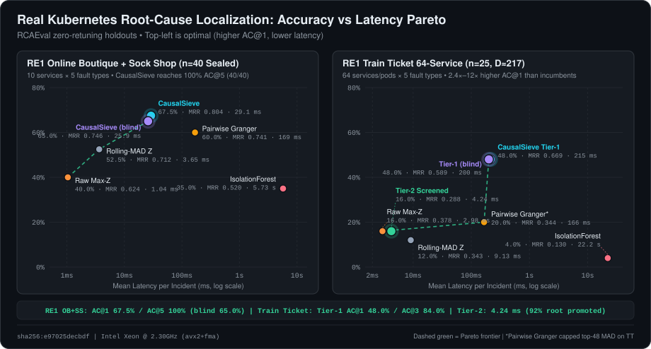
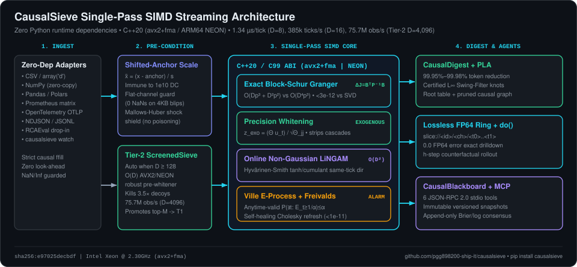

# Kubernetes, Prometheus, OpenTelemetry & Streaming Root-Cause Analysis Cookbook

End-to-end observability recipes for localizing upstream microservice root causes across Prometheus, OpenTelemetry OTLP/JSON, NDJSON/JSONL sidecars, live `causalsieve watch` streams, and the `RCAEval` Kubernetes benchmark.

- **Install:** `pip install causalsieve` (zero runtime Python dependencies; no `numpy`, `pandas`, or HTTP SDK required)
- **Frozen benchmark JSONs:** [`benchmarks/results/rcaeval_suite.json`](../benchmarks/results/rcaeval_suite.json), [`benchmarks/results/rcaeval.json`](../benchmarks/results/rcaeval.json), [`benchmarks/results/rcaeval_trainticket.json`](../benchmarks/results/rcaeval_trainticket.json), [`benchmarks/results/sift_scale.json`](../benchmarks/results/sift_scale.json)



---

## 1. Real Kubernetes Outage Benchmarks (`RCAEval`, `v0.2.0`)

Evaluated strictly one-shot with **zero retuning** against **all 645 real Kubernetes microservice incidents** from `phamquiluan/RCAEval` (`RE1` 375 metric-only + `RE2` 270 OpenTelemetry cases across Online Boutique, Sock Shop, and 64–68 service Train Ticket; `cpu`, `mem`, `disk`, `delay`, `loss`, `socket`).

### Complete RE1 + RE2 OpenTelemetry Suite (`n = 645` Real Outages, `benchmarks/results/rcaeval_suite.json`)

| Method | Micro AC@1 | Micro AC@3 | Micro AC@5 | Micro Avg@5 | Micro MRR | Macro AC@1 | Macro MRR | Mean ms/case |
|---|---:|---:|---:|---:|---:|---:|---:|---:|
| **`causalsieve`** (symmetric) | **75.7%** | **91.0%** | 95.2% | **0.882** | **0.839** | **76.5%** | **0.844** | 160.9 ms |
| `baro_fse24` (Pham et al., FSE'24) | 72.7% | 90.1% | 95.8% | 0.874 | 0.824 | 73.6% | 0.829 | 7.4 ms |
| `nsigma_rcaeval` (RCAEval N-Sigma) | 72.6% | 90.5% | **96.1%** | 0.876 | 0.823 | 73.7% | 0.830 | 3.6 ms |
| `circa_structural_rca` (KDD'22-style) | 71.6% | 86.2% | 91.6% | 0.847 | 0.808 | 72.7% | 0.816 | 44.6 ms |
| `pairwise_granger_z` | 53.5% | 78.4% | 86.4% | 0.745 | 0.681 | 54.9% | 0.689 | 210.3 ms |
| `causalsieve_blind` (zero `inject_time`) | 52.2% | 82.8% | 88.7% | 0.774 | 0.688 | 50.8% | 0.682 | 163.3 ms |
| `rolling_mad_z` | 45.7% | 78.1% | 87.9% | 0.729 | 0.642 | 45.9% | 0.642 | 11.8 ms |

### Original RE1 Sealed Holdout (`n = 40`, `rcaeval.json`) & Train Ticket (`n = 25`, `rcaeval_trainticket.json`)

- **RE1 OB+SS Sealed Holdout (`n=40`):** `causalsieve` **67.5% AC@1 / 92.5% AC@3 / 100.0% AC@5 (40/40) / 0.804 MRR** in **`29.1 ms/case`**; blind (zero `inject_time`) **65.0% AC@1 / 0.746 MRR** in **`25.9 ms/case`** (beats every baseline given `inject_time`).
- **RE1 Train Ticket 64-Svc (`n=25, D≈217`):** `causalsieve_tier1` **48.0% AC@1 / 84.0% AC@3 / 88.0% AC@5 / 0.669 MRR** in **`214.8 ms/case`** (`103×` faster than `IsolationForest` `22,168 ms`, `10.7×` faster than uncapped pairwise Granger `2,307 ms`).

**Honest operational disclosures:**
- On simpler low-D datasets (`RE1-OB`, `RE1-SS`, `RE2-SS`), fast normal-vs-anomalous univariate scorers (`BARO`, `N-Sigma`, `2–5 ms/case`) are within ±1–3 pts of `causalsieve` (`23–30 ms/case`), while `causalsieve` leads clearly on 64–68 service Train Ticket clusters (`RE1-TT` `+7.2 pts`, `RE2-TT` `+5.5 pts`), `RE2-OB` (`+3.3 pts`), and overall micro/macro AC@1 & MRR across all 645 cases.
- Across all 645 incidents, `causalsieve` leads `mem` (`95.8%`), `disk` (`78.3%`), `socket` (`77.8%`), and `cpu` (`75.8%`), while `N-Sigma` edges out `delay` (`75.8%` vs `74.2%`) and `BARO` edges out `loss` (`56.7%` vs `53.3%`).
- On high-dimensional firehose workloads (`D = 128..4,096` with 20% `3.5×`-noise heteroscedastic decoys, `sift_scale.json`), Tier-2 `ScreenedSieve` reaches **75.73M channel-obs/sec** (`18,488 ticks/s` at `D=4,096`) with **100% AC@1** vs `0%` for raw Z-score, rolling MAD-Z, and naive variance; for long `1,441`-tick post-mortem traces (`RE2`), use dense Tier-1 (`use_screened=False`).

---

## 2. Prometheus `/api/v1/query_range` Cookbook

`analyze_prometheus()` parses standard Prometheus matrix JSON (dict, `str`, or `bytes`), aligns misaligned scrape timestamps onto the sorted union timeline with strict causal forward-fill (zero look-ahead), handles `"NaN"`/`"+Inf"`, and formats clean `metric{label=val}` channel names using only the Python standard library.

```python
import urllib.parse
import urllib.request
from causalsieve import analyze_prometheus, recover_handle

# 1. Fetch a multi-service range query with Python stdlib only
params = urllib.parse.urlencode({
    "query": '{namespace="prod",__name__=~"container_cpu_usage_seconds_total|http_request_duration_seconds"}',
    "start": "1710000000",
    "end": "1710001800",
    "step": "5s",
})
url = f"http://prometheus.monitoring.svc:9090/api/v1/query_range?{params}"
with urllib.request.urlopen(url, timeout=10) as resp:
    raw_json = resp.read()

# 2. Run CausalSieve directly on the raw JSON bytes
sieve, digest = analyze_prometheus(raw_json, lag=2, forgetting=0.995, top_k=5)
try:
    print(digest.to_markdown())
    # Drill down to bit-exact IEEE-754 FP64 values for the #1 root-cause handle
    exact_slice = recover_handle(digest.recovery_handles[0])
    print("Recovered ticks:", exact_slice.actual_start, "..", exact_slice.end_tick)
finally:
    sieve.close()
```

---

## 3. OpenTelemetry OTLP/JSON (`analyze_otlp_metrics`)

`analyze_otlp_metrics()` ingests standard OTLP/JSON `ExportMetricsServiceRequest` payloads (`resourceMetrics[].scopeMetrics[].metrics[]`), supporting `gauge`, `sum`, and `histogram` (`sum / count` when `count > 0`, falling back to `sum`) datapoints with `timeUnixNano` (exact 64-bit nanosecond alignment) and `asDouble`/`asInt`. Channels are named `<service.name>_<metric.name>`, appending `{k=v,...}` datapoint attributes only when needed to disambiguate duplicate series.

```python
from causalsieve import analyze_otlp_metrics

# Accepts parsed OTLP/JSON dict, JSON str, or UTF-8 bytes from an OTel Collector file/HTTP exporter
with open("otel_metrics_export.json", encoding="utf-8") as fh:
    otlp_payload = fh.read()

sieve, digest = analyze_otlp_metrics(
    otlp_payload,
    lag=2,
    forgetting=0.995,
    warmup_ticks=120,
    top_k=5,
    token_budget=400,
)
try:
    print(digest.to_markdown())
    for row in digest.root_causes:
        print(f"#{row.rank} {row.name}: score={row.root_score:.2f} exo_z={row.peak_exo_z:+.2f} ({row.verdict})")
finally:
    sieve.close()
```

---

## 4. NDJSON / JSONL Metric Streams (`analyze_jsonl`)

`analyze_jsonl()` parses newline-delimited JSON from a file path, raw multiline JSONL string, or any Python iterable of JSON lines or dicts (e.g., Fluent Bit, Vector, or Kafka consumer records). Non-numeric fields (strings, booleans, nested objects) and timestamp columns are automatically excluded, and missing/non-finite cells are causally forward-filled.

```python
from causalsieve import analyze_jsonl

# Works with a file path, multiline string, or generator of dicts/JSON strings
sieve, digest = analyze_jsonl(
    "cluster_metrics.jsonl",
    time_col="timestamp",     # optional; auto-detected when omitted
    lag=2,
    forgetting=0.995,
    top_k=5,
    token_budget=400,
)
try:
    print(digest.to_markdown())
finally:
    sieve.close()
```

---

## 5. Live Terminal & Sidecar Alerting (`causalsieve watch`)

Stream CSV or JSONL telemetry line-by-line from `stdin` (or a file) with strictly causal tick-by-tick `sieve.push(...)`. Whenever the anytime-valid Ville E-process triggers (`e_value >= 1 / alpha`), `causalsieve watch` immediately flushes a structured JSONL alert (or compact Markdown line) containing `tick`, `e_value`, `max_exo_z`, `top_root_channel`, `top_root_name`, and `ranked_top_k`, followed by a final summary on EOF.

```sh
# Pipe live JSONL telemetry from a collector/tail into causalsieve watch
tail -F /var/log/metrics.jsonl | causalsieve watch --input-format jsonl --lag 2 --alpha 0.01 --top-k 5 --format jsonl

# Auto-detect CSV or JSONL from stdin, emit periodic status every 200 ticks in Markdown
cat incident_metrics.csv | causalsieve watch - --every 200 --warmup 100 --format md

# Stream a file directly with explicit timestamp column exclusion
causalsieve watch pod_metrics.jsonl --time-col ts_unix --lag 2 --forgetting 0.995 --format jsonl
```

Example real-time JSONL alarm line emitted immediately on shock onset:

```json
{"event": "alarm", "tick": 562, "e_value": 184.321, "max_exo_z": 6.412, "top_root_channel": 0, "top_root_name": "db_cpu", "ranked_top_k": [{"rank": 1, "channel": 0, "name": "db_cpu", "root_score": 8.912, "peak_exo_z": 6.412, "raw_z": 4.81, "onset_tick": 560}]}
```

---

## 6. Drop-In `RCAEval` Microservice Integration (`rcaeval_rca`)

`rcaeval_rca()` matches the exact `RCAEval` method contract (`{"ranks", "scores", "metric_top_k", "digest"}`) for Pandas DataFrames, Polars DataFrames, or dict-of-lists with `<service>_<metric>` columns:

```python
import pandas as pd
from causalsieve import rcaeval_rca

df = pd.read_parquet("metrics.parquet")

# Symmetric mode (when incident start timestamp is known)
res = rcaeval_rca(df, inject_time=1693221764, lag=2, forgetting=0.995, top_k=5)
print("Top-5 services:", res["ranks"][:5])

# Fully blind mode (zero knowledge of incident start time)
blind = rcaeval_rca(df, inject_time=None, lag=2, forgetting=0.995, top_k=5)
print("Blind Top-5:", blind["ranks"][:5])

# For D=128..250 post-mortem replay, force Tier-1 dense precision with use_screened=False:
tt_res = rcaeval_rca(df, inject_time=1693221764, use_screened=False)
```

---

## 7. Single-Pass SIMD Pipeline Overview


