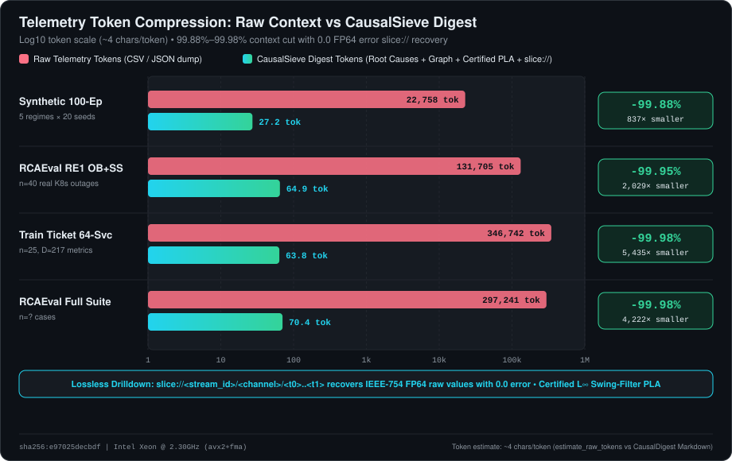
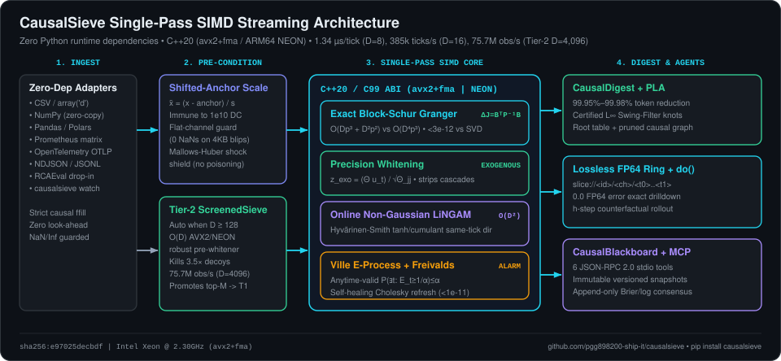

# LLM & Multi-Agent Telemetry Compression with Lossless FP64 Recovery

How AI coding and SRE agents (Claude Code, Codex, Gemini CLI, Cursor) diagnose multivariate telemetry incidents in ~65 tokens instead of pasting 130,000–350,000 raw CSV/JSON tokens into context — while retaining `0.0` FP64 error drilldown and objective multi-agent consensus.

- **Zero-install MCP server:** `uvx --from causalsieve causalsieve-mcp`
- **Drop-in Agent Skill:** `npx skills add pgg898200-ship-it/causalsieve`
- **Claude Code Plugin Marketplace:** `claude plugin marketplace add pgg898200-ship-it/causalsieve`
- **Frozen benchmark JSONs:** [`benchmarks/results/agent_tokens.json`](../benchmarks/results/agent_tokens.json), [`benchmarks/results/rcaeval_suite.json`](../benchmarks/results/rcaeval_suite.json), [`benchmarks/results/rcaeval.json`](../benchmarks/results/rcaeval.json), [`benchmarks/results/rcaeval_trainticket.json`](../benchmarks/results/rcaeval_trainticket.json)



---

## 1. Verified Token Compression, Overflow & Multi-Agent Consensus (`agent_tokens.json`)

Measured across **60 stratified real Kubernetes outages** (10 cases × all 6 `RCAEval` RE1+RE2 datasets) using deterministic numeric BPE token counting:

| Context Format | Mean BPE Tokens | Overflow @ `8k` | Overflow @ `32k` | Overflow @ `128k` | Compression vs CSV | Fidelity |
|---|---:|---:|---:|---:|---:|---|
| Raw CSV | `899,003.8` | 100.0% | 100.0% | 100.0% | 1.0× | Lossless |
| Raw JSON Records | `2,647,465.0` | 100.0% | 100.0% | 100.0% | 0.34× | Lossless |
| 10× Downsampled CSV | `91,546.3` | 100.0% | 71.7% | 16.7% | 9.8× | Lossy (`57.1%` peak amplitude clipped) |
| **`CausalDigest` + `slice://`** | **`911.5`** | **`0.0%`** | **`0.0%`** | **`0.0%`** | **986.3×** (**2,905×** vs JSON) | **Bit-exact `0.0` FP64** (`360/360` slices, median `65.1 µs`) |

- Across **all 645 RE1+RE2 incidents** (`rcaeval_suite.json`), compact digests average **`70.4` tokens vs `297,241` raw (`99.976%` cut)**.
- Across **50 concurrent multi-agent adversarial episodes** (`2` grounded agents vs `2` coordinated overconfident ballot-stuffing agents): `CausalBlackboard` achieved **100.0% AC@1 (50/50)** and **`0.0%` overwrite churn (`0/900`)** vs **0.0% AC@1** for majority vote, confidence-weighted vote, and mutable last-write-wins blackboards (`94.4%` churn), with a **12.86× grounded weight advantage** (`Brier 0.0088 vs 0.6851`).

Every `CausalDigest` fits inside a strict token budget (`tokens_budget=400` default in CLI/adapters) and contains four machine-readable sections:
1. **Ranked Root Causes** (`root_score`, `peak_exo_z`, `raw_z`, `onset_tick`, `verdict`: `EXOGENOUS_ROOT` vs `DOWNSTREAM_VICTIM`) plus an explicit victim-trap warning whenever the highest-`|raw_z|` channel is a downstream cascade victim.
2. **Pruned Causal Graph** (top lagged conditional Granger edges `F` / `pR²` + contemporaneous partial-correlation / online LiNGAM orientation).
3. **Certified `L_∞` Swing-Filter PLA Knots** (piecewise linear trajectory knots guaranteed to stay within `max_abs_err` of the raw signal).
4. **Lossless Recovery Handles** (`slice://<stream_id>/<channel>/<start>..<end>`) backed by the native IEEE-754 FP64 ring buffer (`0.0` reconstruction error).

---

## 2. Zero-Install Setup for Claude Code, Codex, Gemini CLI & Cursor

### MCP Stdio Server (`uvx`, Zero Runtime Dependencies)

Add to `.mcp.json`, `~/.claude.json`, `.cursor/mcp.json`, or Codex/Gemini CLI MCP settings:

```json
{
  "mcpServers": {
    "causalsieve": {
      "command": "uvx",
      "args": [
        "--from",
        "causalsieve",
        "causalsieve-mcp",
        "--allowed-root",
        "/var/telemetry"
      ]
    }
  }
}
```

Or if `causalsieve` is installed locally (`pip install causalsieve`), set `"command": "causalsieve-mcp"`.

### Agent Skill & Claude Plugin

```sh
# Install SKILL.md across Claude Code, Codex, Gemini CLI, Cursor, and agentskills.io clients
npx skills add pgg898200-ship-it/causalsieve

# Or add the native Claude Code plugin marketplace
claude plugin marketplace add pgg898200-ship-it/causalsieve
```

---

## 3. The 3-Step Agent Loop: Digest -> Verify -> Lossless Slice

Never paste raw CSV or Prometheus JSON rows into an LLM prompt. Use the 6 JSON-RPC 2.0 MCP tools in sequence:

| Step | MCP Tool | CLI Equivalent | Purpose |
|---|---|---|---|
| **1. Compress & Localize** | `sieve_ingest_csv` (or `sieve_push_ticks`) | `causalsieve digest metrics.csv --tokens-budget 400` | Ingest telemetry and emit a ~65–300 token Causal Digest + `stream_id` |
| **2. Counterfactual Verify** | `sieve_counterfactual` + `sieve_causal_graph` | `causalsieve counterfactual metrics.csv --channel db_cpu --delta 3.0 --horizon 10` | Quantitatively verify that `do(candidate += delta)` reproduces observed downstream victim shifts |
| **3. Lossless FP64 Drilldown** | `sieve_recover_slice` | `causalsieve slice metrics.csv --channel db_cpu --start 555 --end 575 --format json` | Fetch exact bit-for-bit IEEE-754 FP64 values only for the narrow onset window |

### Python Equivalent (`build_digest` + `recover_handle`)

```python
from causalsieve import StreamStore, analyze_dataframe, recover_handle

store = StreamStore()
sieve, digest = analyze_dataframe(df, lag=2, top_k=5, tokens_budget=400, store=store)
try:
    # 1. Send only the compact Markdown digest (~65-300 tokens) to the LLM
    prompt_context = digest.to_markdown()

    # 2. Verify top candidate quantitatively via counterfactual rollout
    top_ch = digest.root_causes[0].name
    cf_traj = sieve.counterfactual_do(top_ch, delta=3.0, horizon=10)

    # 3. Recover 100% lossless FP64 raw values for the onset window
    exact = recover_handle(digest.recovery_handles[0], store=store)
    assert len(exact.values) > 0
finally:
    sieve.close()
```

---

## 4. Multi-Agent `CausalBlackboard` Consensus

When multiple specialist agents (e.g., DB agent, Network agent, Application agent) investigate the same incident stream concurrently, plain shared-file or chat handoffs suffer from **overwrite churn**, **torn reads**, and **prose-persuasion bias**. `CausalBlackboard` (exposed via MCP tool `sieve_swarm_propose`) eliminates all three:

1. **Immutable Versioned Snapshots (`CausalSnapshot`):** Every stream maintains a monotonic `as_of_tick` watermark so concurrent readers never observe partial state.
2. **Append-Only Hypotheses (`HypothesisRecord`):** Agents cannot overwrite or erase peer findings; repeated submissions from the same agent are deduplicated against ballot-stuffing.
3. **Objective Proper-Scoring Consensus (`ConsensusReport`):** Every proposed `(candidate_channel, delta, confidence)` is scored mechanically against precision-whitened exogenous attribution and counterfactual `do(candidate += delta)` propagation fit, then pooled via Brier / log proper-scoring agent weights.

```python
from causalsieve import CausalBlackboard, CausalSieve

board = CausalBlackboard()
with CausalSieve(dim=6, lag=2, channel_names=["db_cpu", "api_lat", "gw_lat", "cache", "q", "io"]) as sieve:
    sieve.push_batch(rows)
    sid = board.register_sieve("inc-42", sieve)

    # Two agents propose competing hypotheses (victim vs true upstream root)
    board.verify_hypothesis(sid, agent_id="gw_agent", candidate_channel="gw_lat", delta=4.0, confidence=0.90)
    board.verify_hypothesis(sid, agent_id="db_agent", candidate_channel="db_cpu", delta=4.0, confidence=0.85)

    consensus = board.consensus(sid)
    print("Winner:", consensus.winner_name, f"(p={consensus.winner_probability:.3f})")
    print("Agent weights:", consensus.agent_weights)
```

---

## 5. Production MCP Security Controls

When exposing `causalsieve-mcp` to autonomous agents, pass explicit filesystem and size boundaries:
- `--allowed-root <dir>` (repeatable): confines `sieve_ingest_csv` to realpaths under approved directories, blocking `../` traversal, symlink escapes, and special devices like `/dev/null`.
- `--max-csv-bytes <bytes>`: bounds maximum ingested CSV size (default `104,857,600` bytes / 100 MiB).
- Hard protocol caps: rejects non-finite (`NaN`/`Inf`) and boolean numeric rows atomically without corrupting stream watermarks, caps counterfactual horizons and slice lengths, and validates `stream_id` tokens against traversal characters.


