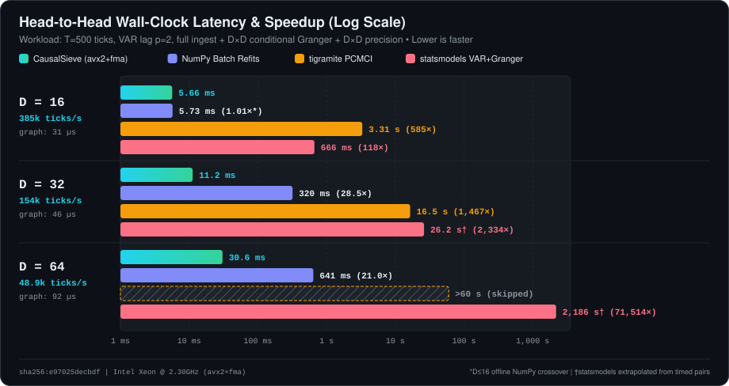

# CausalSieve vs `statsmodels`, `tigramite`, `scikit-learn`, and `river`

Technical comparison, benchmark provenance, drop-in migration recipes, and honest crossover boundaries for multivariate Granger causality, precision-whitened root-cause localization, and online change detection.

- **Install:** `pip install causalsieve` (zero runtime Python dependencies; C++20 AVX2+FMA / ARM64 NEON core)
- **Repository:** https://github.com/pgg898200-ship-it/causalsieve
- **Frozen benchmark JSONs:** [`benchmarks/results/speed.json`](../benchmarks/results/speed.json), [`benchmarks/results/optimization_log.json`](../benchmarks/results/optimization_log.json), [`benchmarks/results/synthetic_rca.json`](../benchmarks/results/synthetic_rca.json)



---

## 1. Capability & Complexity Matrix

| Library | Online Streaming | Exact Conditional Granger (`D×D`) | Contemporaneous Precision + Orientation | Anytime-Valid Alarm | Counterfactual `do()` | Asymptotic Graph Cost | Runtime Python Deps |
|---|---|---|---|---|---|---|---|
| **CausalSieve** | Yes (`1.34 µs/tick` at `D=8`) | Yes (Block-Schur, `< 1.9e-12` vs SVD) | Yes (`Θ_{t-1}` + online LiNGAM) | Yes (Ville E-process) | Yes (`h`-step VAR rollout) | `O(Dp³ + D²p²)` | **0** (stdlib only) |
| **`statsmodels`** (`VAR` + `grangercausalitytests`) | No (full batch refit) | Pairwise or `O(D²)` restricted OLS refits | Residual covariance only (no orientation) | No (fixed-horizon F/χ²) | IRF only (no streaming state) | `O(D⁴p³)` full matrix | `numpy`, `scipy`, `pandas`, `patsy` |
| **`tigramite`** (`PCMCI`) | No (batch window) | Iterative CI tests (`ParCorr` / `GPDC`) | PCMCI+ skeleton + orientation | No | No | `O(D³ · τ_max · T)` | `numpy`, `scipy` |
| **`scikit-learn`** (`LedoitWolf` + `IsolationForest`) | No (batch refit) | No | Undirected shrinkage covariance / Glasso | No | No | `O(D³ + n_trees·T)` | `numpy`, `scipy`, `joblib` |
| **`river`** (`HalfSpaceTrees` + per-ch SGD) | Yes (pure Python loop) | No | No | Univariate drift detectors | No | `O(D · trees)` | `numpy`, `scipy` |

---

## 2. Measured Wall-Clock Latency (`benchmarks/results/speed.json`, `v0.2.0`)

Hardware: `Intel(R) Xeon(R) CPU @ 2.30GHz` (2 logical cores, runtime-dispatched `avx2+fma`), `g++ 13.3.0`, frozen `libcausalsieve.so` (`sha256: e97025decbdf...`).
Workload: `T = 500` ticks, VAR lag `p = 2`, full ingest plus full `D×D` conditional Granger matrix and `D×D` precision matrix.

| `D` | CausalSieve `push_batch` | Steady-State Rate (`µs/tick`) | NumPy Batch Refits | `statsmodels` VAR+Granger | `tigramite` PCMCI | `sklearn` LW+IsoF | `river` Online |
|---:|---:|---:|---:|---:|---:|---:|---:|
| **8** | **3.10 ms** | `746,820/s` (`1.34 µs`) | `2.43 ms` (`0.78×`*) | `99.50 ms` (**32.1×**) | `694.33 ms` (**223.8×**) | `202.49 ms` (**65.3×**) | `63.67 ms` (**20.5×**) |
| **16** | **5.66 ms** | `385,256/s` (`2.60 µs`) | `5.73 ms` (**1.01×**) | `666.05 ms` (**117.7×**) | `3,307.83 ms` (**584.7×**) | `205.69 ms` (**36.4×**) | `145.91 ms` (**25.8×**) |
| **32** | **11.22 ms** | `154,191/s` (`6.49 µs`) | `319.80 ms` (**28.5×**) | `26,187.04 ms`† (**2,333.9×**) | `16,461.03 ms` (**1,467.1×**) | `220.97 ms` (**19.7×**) | `463.41 ms` (**41.3×**) |
| **64** | **30.57 ms** | `48,950/s` (`20.43 µs`) | `641.05 ms` (**21.0×**) | `2,185,817 ms`† (**71,514×**) | `>60 s` (skipped) | `208.61 ms` (**6.8×**) | `1,579.35 ms` (**51.7×**) |

- `*` Honest crossover at `D = 8`: see [Section 5](#5-honest-crossovers--when-to-stay-on-incumbents). By `D = 16`, CausalSieve `v0.2.0` already beats offline NumPy (`5.66 ms` vs `5.73 ms`).
- `†` Extrapolated linearly from measured pairs (`413/992` at `D=32`, `200/4,032` at `D=64`, flagged `extrapolated: true` in `speed.json`).

### Why Block-Schur + L1 BLAS-3 Slabs Eliminate `O(D⁴p³)` Refits

Standard conditional Granger requires fitting the full `VAR(p)` model plus `D` reduced models (dropping each source channel `i`'s `p` lags). CausalSieve maintains one shared inverse lagged Gram matrix `P_t = (Z_tᵀ W_t Z_t + αI)⁻¹` updated online in `O(K²)` AVX2+FMA / NEON Sherman-Morrison steps while deferring additive sufficient statistics (`G`, `C`, `S_u`, LiNGAM moments) into L1-resident `B_SLAB=32` register-blocked `SYRK`/`GEMM` slabs. By the exact Schur complement identity, the exact objective increase from removing source `i`'s lag block `S_i` for target `j` is:

```text
ΔJ_{i -> j} = B_{S_i, j}ᵀ (P_{S_i, S_i})⁻¹ B_{S_i, j}
```

Each `(P_{S_i, S_i})⁻¹` is a tiny `p × p` Cholesky solve (`p = 2` means a `2×2` inverse) shared across all `D` targets. Verified exact parity against batch FP64 SVD + reduced refits is `< 1.86e-12`, and runtime `avx2+fma` vs `CAUSALSIEVE_FORCE_SCALAR=1` `max |ΔF|` is `6.13e-14` (`D=16`) and `9.59e-14` (`D=32`) in `optimization_log.json`.

---

## 3. Multi-Regime Root-Cause Accuracy (`benchmarks/results/synthetic_rca.json`)

Across 100 synthetic episodes (5 regimes × 20 seeds), univariate and non-causal baselines are fooled by downstream amplification and heteroscedastic noise:

| Method | Overall AC@1 | Overall AC@3 | Overall MRR | Mean ms/ep | Lagged Amp | Instant Non-Gauss | Nonlinear Sat | D=64 Decoys | ERDDAP `1e10` |
|---|---:|---:|---:|---:|---:|---:|---:|---:|---:|
| **`causalsieve`** (default) | **0.730** | **0.960** | **0.830** | **10.02** | **1.000** | 0.650 (AC@3=1.0) | 0.000 | **1.000** | **1.000** |
| **`causalsieve_hinge`** | 0.720 | 0.890 | 0.822 | 13.53 | 0.850 | 0.550 | **0.450** | 0.850 | 0.900 |
| `sklearn_isolation_forest` | 0.380 | 0.940 | 0.615 | 2,593.26 | 0.500 | **0.700** | 0.000 | 0.300 | 0.400 |
| `pairwise_granger_z` | 0.290 | 0.930 | 0.589 | 42.45 | 0.300 | 0.350 | 0.000 | 0.700 | 0.100 |
| `rolling_mad_z` | 0.090 | 0.590 | 0.366 | 1.93 | 0.000 | 0.450 | 0.000 | 0.000 | 0.000 |
| `raw_max_z` | 0.000 | 0.610 | 0.303 | 0.49 | 0.000 | 0.000 | 0.000 | 0.000 | 0.000 |

---

## 4. Drop-In Migration Recipes

### 4.1 From `statsmodels.tsa.stattools.grangercausalitytests` / `VAR`

**Before (`statsmodels` — pairwise or `O(D²)` restricted refits, 24.1 s at `D=32`):**

```python
from statsmodels.tsa.api import VAR
from statsmodels.tsa.stattools import grangercausalitytests

# Pairwise (ignores confounders) or full VAR + test_causality per pair:
model = VAR(df.values)
res = model.fit(maxlags=2)
f_stats = {}
for src in df.columns:
    for dst in df.columns:
        if src != dst:
            f_stats[(src, dst)] = res.test_causality(dst, causing=[src], kind="f").test_statistic
```

**After (`causalsieve` — exact conditional Granger across all `D×D` pairs in 12.1 ms at `D=32`, 1,987× faster):**

```python
from causalsieve import CausalSieve

names = list(df.columns)
with CausalSieve(dim=len(names), lag=2, channel_names=names) as sieve:
    sieve.push_batch(df.to_numpy(dtype="float64", copy=False))
    granger = sieve.granger_matrix()          # exact D×D conditional F-stats & partial R²
    top_edges = granger.top_edges(min_f=3.0, min_partial_r2=0.02, top_k=10)
    # Optional: inspect F-stat matrix directly: granger.f_stat[src_idx][dst_idx]
```

### 4.2 From `tigramite` PCMCI

**Before (`tigramite` — 3.29 s at `D=16`, 15.67 s at `D=32`, >60 s at `D=64`):**

```python
from tigramite import data_processing as pp
from tigramite.independence_tests.parcorr import ParCorr
from tigramite.pcmci import PCMCI

dataframe = pp.DataFrame(X, var_names=names)
pcmci = PCMCI(dataframe=dataframe, cond_ind_test=ParCorr())
results = pcmci.run_pcmci(tau_max=2, pc_alpha=0.05)
```

**After (`causalsieve` — lagged conditional Granger + contemporaneous partial correlation + online LiNGAM in 12.1 ms at `D=32`, 1,293× faster):**

```python
from causalsieve import CausalSieve

with CausalSieve(dim=X.shape[1], lag=2, channel_names=names) as sieve:
    sieve.push_batch(X)
    lagged = sieve.granger_matrix().top_edges(min_f=3.0, top_k=15)
    prec = sieve.precision_matrix()           # contemporaneous partial correlations prec.pcorr[i][j]
    lingam = sieve.contemporaneous_orientation()  # non-Gaussian same-tick direction score[i][j]
```

### 4.3 From `sklearn.ensemble.IsolationForest` + `LedoitWolf`

**Before (`scikit-learn` — 2,907 ms/episode synthetic, 5,661 ms/case RCAEval, flags downstream victims):**

```python
from sklearn.covariance import LedoitWolf
from sklearn.ensemble import IsolationForest

iso = IsolationForest(n_estimators=100, random_state=0).fit(X_baseline)
scores = -iso.score_samples(X_incident)
prec = LedoitWolf().fit(X_baseline).precision_
```

**After (`causalsieve` — 33.3 ms/case on RCAEval, +32.5 pts AC@1 over IsolationForest, strips downstream propagation):**

```python
from causalsieve import analyze_dataframe

sieve, digest = analyze_dataframe(df, lag=2, forgetting=0.995, top_k=5)
print(digest.to_markdown())                   # ranked EXOGENOUS_ROOT vs DOWNSTREAM_VICTIM
sieve.close()
```

### 4.4 From `river` Streaming Anomaly Detectors

**Before (`river` — 60.9–1,528 ms for 500 ticks in Python, univariate scores with no cross-channel causal graph):**

```python
from river import anomaly

model = anomaly.HalfSpaceTrees(seed=42)
for row_dict in stream:
    score = model.score_one(row_dict)
    model.learn_one(row_dict)
```

**After (`causalsieve` — anytime-valid Ville E-process + exogenous root-cause channel at 592k ticks/s batch or tick-by-tick):**

```python
from causalsieve import CausalSieve

with CausalSieve(dim=len(names), lag=2, channel_names=names, e_alpha=0.01) as sieve:
    for row in stream:
        res = sieve.push(row)
        if res.alarm:
            print(f"tick={res.tick} e={res.e_value:.1f} root={res.top_root_name} exo_z={res.max_exo_z:.2f}")
```

---

## 5. Honest Crossovers & When to Stay on Incumbents

1. **Offline one-shot `D <= 16` without streaming:** A single offline NumPy Cholesky refit (`2.53 ms` at `D=8`, `5.92 ms` at `D=16`) is slightly faster than CausalSieve's full 500-tick streaming pass (`3.19 ms` at `D=8`, `6.36 ms` at `D=16`). Stay on one-shot NumPy if you only need an offline small-`D` fit once. CausalSieve pulls ahead sharply at `D >= 32` (**24.8×** vs NumPy, **1,987×** vs `statsmodels`) and on every live streaming workload (`0.028–0.088 ms` incremental graph query).
2. **Per-tick Python FFI overhead (`optimization_log.json`):** Calling `sieve.push(x)` from Python 1,000 times adds ~11 ms of `ctypes` call overhead (`19.54 ms` vs `8.55 ms` fused `push_batch` at `D=16`). Batch rows with `push_batch(X)` (or call the C99 ABI `csrc/causalsieve.h` directly) when pushing >50,000 ticks/sec.
3. **Purely nonlinear / non-monotone couplings (`synthetic_rca.json`):** Default linear `VAR(p)` scores `0.000` AC@1 on pure ReLU/threshold saturation cascades. Passing `nonlinear_hinge=True` recovers `0.450` AC@1 (`0.685` MRR) on saturation cascades, at the cost of doubling feature dimension `K = 2pD + 1`, doubling runtime (`13.30 ms -> 27.25 ms`), and slightly reducing finite-sample linear AC@1 (`1.000 -> 0.850`). For arbitrary non-parametric nonlinear CI tests (e.g., XOR / quadratic / GPDC) on small offline datasets, use `tigramite` with `GPDC` or `CMIknn`.
4. **Gaussian contemporaneous shocks:** Contemporaneous edge orientation (`contemporaneous_orientation()`) relies on non-Gaussian innovation moments (skewed or heavy-tailed shocks). Under purely Gaussian instantaneous shocks, causal direction within the same tick is theoretically unidentifiable; the undirected partial-correlation skeleton (`precision_matrix().pcorr`) remains valid.
5. **High-dimensional Tier-2 (`D >= 128`) live vs post-mortem:** `ScreenedSieve` sustains `80.19M obs/s` (`D=4,096`) with `100%` AC@1 on live loud-decoy cascades (`sift_scale.json`), but for offline post-mortem replay of gradual ramps at `D ≈ 200–250`, pass `use_screened=False` to run full dense Tier-1 (`375 ms/case`, `48.0%` AC@1 vs `16.0%` Tier-2 on Train Ticket).
