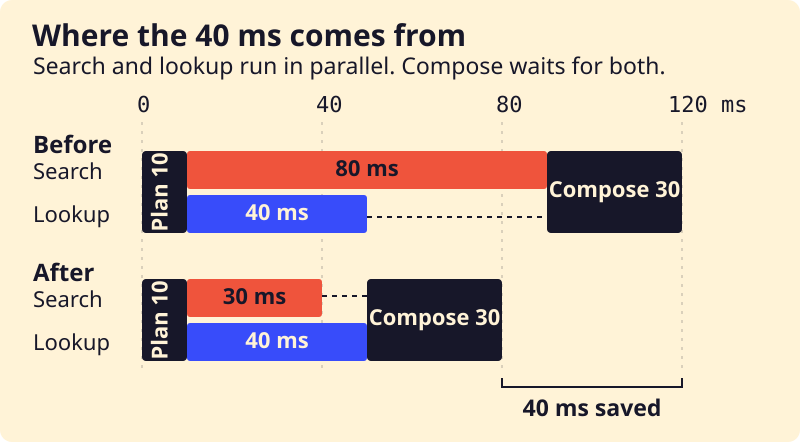

# PathProbe DAG

**Which tool call would actually make a parallel workflow finish sooner?** PathProbe indexes a workflow once and gives the exact modeled completion time after changing one task. Use it to rank latency work, test a slower but cheaper tool, or find the largest tool latency compatible with a deadline across recorded runs.

[Try it with your own graph in the browser](https://huggingface.co/spaces/pgg-engineering/pathprobe-dag) · [Native benchmark results](bench/results-native.json) · [Million-task results](bench/results-capacity.json)

## The 50 ms optimization that saves 40 ms

A planner takes 10 ms, launches an 80 ms search and a 40 ms lookup in parallel, then spends 30 ms composing the result. Cutting search to 30 ms takes the workflow from **120 to 80 ms**. Lookup now sets the floor. Making search instantaneous still buys only 40 ms. Accelerating a task common to both branches can save its entire duration.



Install or upgrade the Python CLI (Python 3.10+, no runtime dependencies). Version 0.1.1 checks for conflicting time units when combining workflow captures.

```sh
python -m pip install --upgrade 'https://raw.githubusercontent.com/pgg898200-ship-it/causalsieve/main/tools/pathprobe/downloads/pathprobe_dag-0.1.1-py3-none-any.whl'
```

```python
from pathprobe import DurationIndex

run = DurationIndex(
    {"plan": 10, "search": 80, "lookup": 40, "compose": 30},
    [("plan", "search"), ("plan", "lookup"),
     ("search", "compose"), ("lookup", "compose")],
)
print(run.makespan)                 # 120
print(run.predict("search", 30))    # 80
print(run.predict("lookup", 110))   # 150
print(run.profile("search"))        # duration=80, through=120, bypass=80, max_saving=40
```

The CLI reads one graph with a `durations` object and an `edges` array of prerequisite/dependent pairs. Any consistent nonnegative integer unit works. From this project directory:

```sh
python -m pathprobe rank examples/run.json --top 3
python -m pathprobe predict examples/run.json search 30
```

## What latency budget can we give this tool?

For each recorded run, PathProbe computes the largest replacement duration at which that run would meet its deadline. If a different branch already exceeds the deadline, optimizing this task cannot rescue that run. Across many runs, a sorted list of these budgets gives the number meeting their deadlines at a proposed duration in O(log R) and the inverse budget for a required count in O(1).

```sh
python -m pathprobe fleet examples/cohort.jsonl search --duration 30 --required 2
# {"task": "search", "runs": 3, "impossible": 1, "duration": 30, "met": 2, "required": 2, "limit": 40}
```

Each JSON line contains one workflow graph and its integer `deadline`. Supply one time unit and the same logical task name across all rows. The CLI checks declared unit labels in `time_unit` (Dask) and `source.unit` (GitHub Actions). Convert all durations and deadlines to the same unit and update the labels before combining captures. For rows without labels, supply values in the cohort unit. This three-run example is synthetic. Each historical run gets one vote. Counts are conditional on the supplied cohort and the other tasks retaining their durations. For repeated queries in a process, build `FleetBudget.from_runs((index, task_name, deadline) for ...)` once, then call `.met(duration)` or `.limit(required_runs)`.

### Three recorded SDK releases

Three public [OpenAI Agents SDK release workflows](examples/actions/README.md) supply a small real cohort. On these inputs, the largest modeled duration for the checks job that keeps at least two of the three workflows within a hypothetical 900-second deadline is **849 seconds**.

```sh
python -m pathprobe fleet examples/actions/agents-sdk-releases.jsonl checks --duration 845 --required 2
```

The October 2 run also shows where the model stops. A 300-second wait between two jobs contributed to an observed span of 1,353 seconds. The dependency-only critical path was 1,048 seconds. These three public records supply example inputs, and the deadline is a scenario assumption.

### A CI optimization case study

In an independent analysis of four public SAPPHIRE workflow runs, speeding up a single unit-test shard saved zero modeled wall time in every run. A two-minute improvement to the Aquacast image-proof job saved between zero and two minutes, depending on the parallel integration path. The case study includes the pinned workflow, measured job timings and an offline script. [Reproduce the SAPPHIRE analysis](examples/sapphire-ci/README.md).

## Capture a workflow

To capture a completed GitHub Actions run, supply its repository, run and attempt numbers, and an explicit map of job dependencies. The [Actions capture guide](examples/actions/CAPTURE.md) shows how to replay the result and compare modeled completion with observed elapsed time.

The optional Dask Distributed adapter captures a fresh computation and joins the scheduler’s optimized task dependencies to worker compute intervals. It rejects incomplete measurements and ambiguous attempts. The adapter was exercised end-to-end with 1,023 tasks on four local workers.

```sh
python -m pip install 'dask[distributed]'
python examples/dask_capture.py | python -m pathprobe rank - --top 5
```

For an existing workload, call `capture(client, collection)` from [the Dask example](examples/dask_capture.py). The return value contains the computed result and a graph record.

## Native kernel

Copy [pathprobe.hpp](native/pathprobe.hpp) into a C++17 project. Supply dense integer task IDs and signed 64-bit durations. Construction checks for cycles, invalid endpoints and overflow. Concurrent read-only queries on the finished index are safe.

```cpp
#include "pathprobe.hpp"
pathprobe::DurationIndex run({10, 80, 40, 30}, {{0,1}, {0,2}, {1,3}, {2,3}});
// run.makespan() == 120; run.predict(1, 30) == 80
```

## When does building the index pay off?

The table reports median wall time to construct each C++ index and answer one shuffled edit per task. The two recorded scientific workflows use measured durations and dependency edges from [WfCommons](bench/data/README.md). Edits are simulated. Lazy critical-path caching and a separately implemented eager heap index both exploit path structure. The full-replay baseline already uses integer task IDs and a precomputed topological order.

| Workflow | Tasks | PathProbe | Fastest tested alternative | Full replay |
| --- | ---: | ---: | ---: | ---: |
| Montage astronomy | 472 | **18.06 µs** | 21.75 µs, lazy cache | 948.02 µs |
| Cycles agriculture | 134 | 2.65 µs | **2.53 µs**, lazy cache | 37.68 µs |
| Synthetic layered DAG | 2,048 | **169.59 µs** | 440.17 µs, eager heap | 22,687.33 µs |
| Synthetic detours | 2,048 | **99.69 µs** | 114.17 µs, eager heap | 15,388.68 µs |

Full replay won all four single-query comparisons. For repeated queries on one fixed graph, the index amortizes its build cost. Each answer is a pair of bounds and a maximum.

At **1,000,002 tasks and as many edits**, serial diamonds took **80.85 ms** with PathProbe versus **145.71 ms** with the eager heap. Parallel chains took **92.58 ms** versus **88.44 ms**. Peak process memory on parallel chains was 132.24 MiB and 171.49 MiB, respectively, including inputs, queries and answers. Each method ran in nine fresh processes per topology on shared x86-64 Linux (AMD EPYC 9V74). Raw trials include CPU and wall time. These are synthetic, in-process measurements.

Reproduce from the project directory:

```sh
python -m unittest discover -s tests
c++ -std=c++17 -O2 native/check.cpp -o /tmp/pathprobe-check && /tmp/pathprobe-check
python bench/export_native.py --input bench/data/cycles.json --input bench/data/montage.json
python bench/capacity.py
python bench/compare.py --input bench/data/cycles.json --input bench/data/montage.json
```

If you benchmark your own workflow, share the graph size, comparison method, query count and timings including index construction. We welcome cases where PathProbe wins or loses. [Report an independent reproduction](https://github.com/pgg898200-ship-it/causalsieve/issues/new).

## Model and prior work

Tasks start when all prerequisites finish. Roots start at time zero. All sinks must finish. Inputs may contain ties, zero-duration tasks and disconnected components. Each query independently replaces one duration on the original graph. Rebuild the index after changing topology or baseline durations. Resource contention, network queues, cache feedback, retries and nested spans need explicit modeling. Raw parent/child telemetry can double-count enclosing spans if imported as finish-to-start edges.

Every complete path either visits the edited task or bypasses it. Paths through the task change by the duration difference. The longest bypass stays fixed. The answer is `max(bypass, through - old_duration + new_duration)`, ignoring a missing bypass. Each edge crossing a task’s topological position supplies a candidate bypass. PathProbe aggregates those candidates only for tasks on a representative longest path. Other tasks already have a makespan-length bypass. Build time is O(V + E log(C+1)) for C tasks on that path, with O(V+E) build space, O(V) retained space, and constant-time arbitrary duration queries under fixed-width arithmetic.

Critical-path drag and replacement paths are established ideas. [Buck2 reports potential improvements for build critical paths](https://buck2.build/docs/users/commands/log/). [Its implementation](https://github.com/facebook/buck2/blob/fc3d2d79187f1bea090bae74b4f9643bd04cb52e/app/buck2_critical_path/src/potential.rs) is a relevant alternative for Buck2 users. The comparisons above measure the implementations under [bench/](bench/), and leave Buck2 itself unmeasured. PathProbe exposes a portable duration index, a historical deadline-budget query and a local file format across runtimes.

Project code is MIT licensed. Redistribution terms for the WfCommons numeric fixtures are included in [bench/data](bench/data/README.md).
